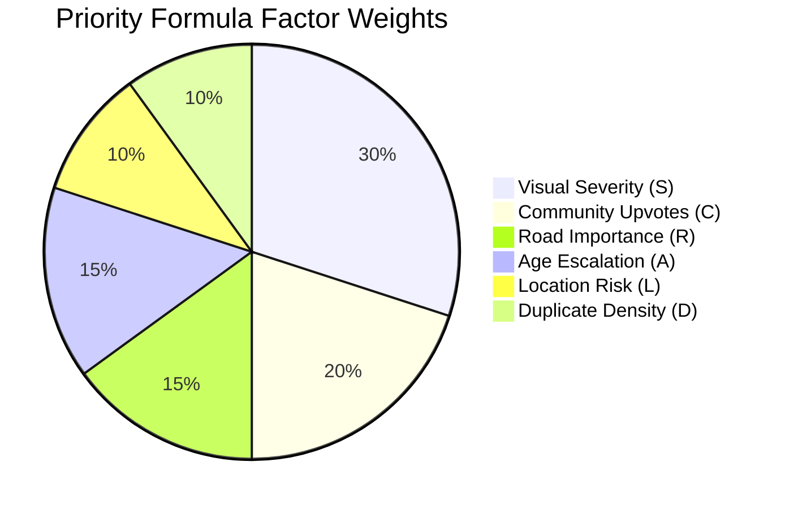
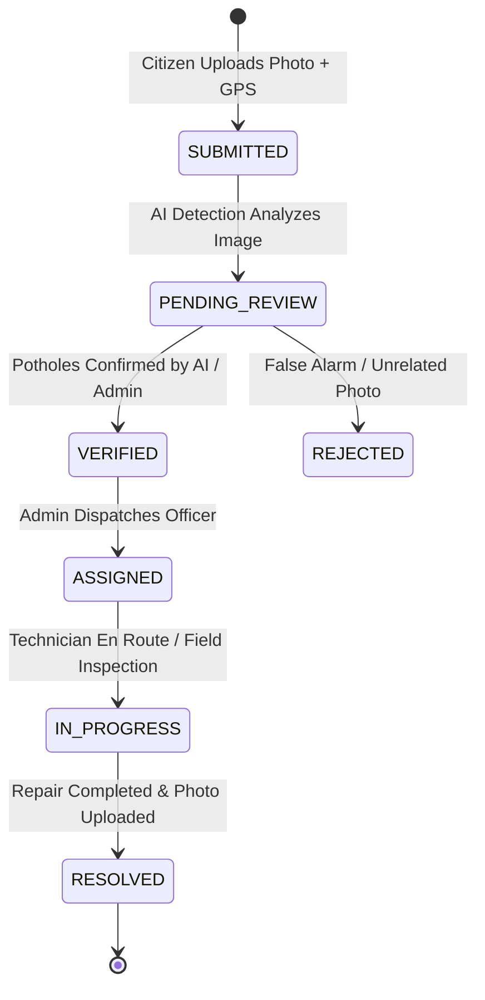

# FixMyRoad AI — System Architecture & Engineering Design

This document details the architectural decisions, structural patterns, and computational design of the **FixMyRoad AI** infrastructure management platform.

---

## 1. Architectural Philosophy

FixMyRoad AI is engineered according to four fundamental design principles:
1. **Decoupled Service Boundaries**: Clear separation between UI representation (React 19), REST API routing (FastAPI), compute engines (Computer Vision, Geospatial, XGBoost), and relational persistence (PostgreSQL / SQLite).
2. **Defensive Compute Fallbacks**: Computer Vision, Prioritization, and GIS calculations never hard-fail on host constraints. If GPU or cloud APIs are unavailable, the system automatically falls back to local mathematical and contour analysis.
3. **Transparent & Explainable AI**: No opaque "black-box" scores. All priority rankings and visual damage estimates expose exact mathematical components, bounding box coordinates, and natural-language justifications.
4. **Zero Hardcoded Secrets**: Complete isolation of authentication, API keys, database endpoints, and tokens into environment variables (`.env`).

---

## 2. High-Level System Architecture

```mermaid
graph TB
    subgraph Presentation Tier (React 19 + TypeScript)
        UI_Citizen[Citizen Reporting Portal\nGPS Map + Camera Feed]
        UI_Officer[Field Technician Workspace\nWork Order Completion]
        UI_Admin[Municipal Dispatch\nPriority Override & Assignments]
        UI_GIS[Interactive GIS Map\nCluster Corridors]
        UI_Analytics[Analytics & MTTR\nML Duration Simulator]
        UI_Bridge[Bridge ML Portal\nLifespan Prediction]
    end

    subgraph API Gateway & Controller Layer (FastAPI)
        Router[APIRouter /api/v1]
        Auth_MW[Bcrypt + JWT Middleware]
        RBAC_MW[Role Guard: Citizen | Officer | Admin]
    end

    subgraph Compute & Machine Learning Tier
        CV_Engine[Computer Vision Pipeline\nYOLOv8 + OpenCV Saliency]
        Prio_Engine[6-Factor Priority Engine\nMathematical Weighted Index]
        GIS_Engine[Geospatial Engine\nHaversine + DBSCAN Clustering]
        Bridge_Engine[XGBoost ML Regressor\nBridge Lifespan Degradation]
        MTTR_Engine[Supervised Duration Estimator\nTurnaround Forecaster]
    end

    subgraph Persistence & Asset Tier
        DB_Postgres[(PostgreSQL 16 + PostGIS\nSpatial SQLite for Dev)]
        Media_Store[(Cloudinary CDN /\nLocal Disk Storage)]
        Model_Store[(Serialized ML Models\n.pkl & .pt artifacts)]
    end

    Presentation Tier --> Router
    Router --> Auth_MW
    Auth_MW --> RBAC_MW
    RBAC_MW --> CV_Engine
    RBAC_MW --> Prio_Engine
    RBAC_MW --> GIS_Engine
    RBAC_MW --> Bridge_Engine
    RBAC_MW --> MTTR_Engine
    Compute & Machine Learning Tier --> DB_Postgres
    CV_Engine --> Media_Store
    Bridge_Engine --> Model_Store
```

---

## 3. Core Subsystems

### 3.1. Computer Vision & Pothole Detection Pipeline (`ai_service.py`)
- **Stage 1: Pre-processing & Sanitization**:
  Images undergo format verification, dimension scaling, and normalization.
- **Stage 2: Local Ultralytics YOLOv8 Inference**:
  If custom weights (`models/yolov8n.pt`) are present, YOLO identifies crater coordinates $[x_1, y_1, x_2, y_2]$ and class confidences.
- **Stage 3: Structural OpenCV Contour & Saliency Analyzer**:
  Operates 100% offline without GPU or external internet access. Converts image to grayscale, applies Gaussian blur $(7 \times 7)$, computes adaptive Gaussian thresholding, executes elliptical morphological closure, and analyzes contour area ratio and aspect ratio ($0.3 \le \text{aspect} \le 3.5$).
- **Stage 4: Roboflow Cloud API Fallback**:
  If `ROBOFLOW_API_KEY` is configured, issues an asynchronous prediction request to Roboflow's hosted API.
- **Stage 5: High-Contrast Visual Annotation**:
  Draws color-coded bounding rectangles (Crimson for Critical, Orange for High, Gold for Medium, Forest Green for Low), alpha-blended damage highlights ($15\%$ fill opacity), and municipal watermark banners.
- **Stage 6: Explainable Severity Reasoner**:
  Synthesizes pothole count, surface damage area ratio, and average confidence into a transparent assessment sentence.

### 3.2. Dynamic 6-Factor Prioritization Math Engine (`priority_service.py`)
Every report receives a composite score $\in [0, 100]$:

$$\text{Priority} = (0.30 \times S) + (0.20 \times C) + (0.15 \times R) + (0.15 \times A) + (0.10 \times L) + (0.10 \times D)$$



1. **$S$ (Visual Severity Component, 30%)**:
   - Critical: 100 points ($30.0$ weighted)
   - High: 75 points ($22.5$ weighted)
   - Medium: 45 points ($13.5$ weighted)
   - Low: 20 points ($6.0$ weighted)
2. **$C$ (Community Evidence Component, 20%)**:
   $$C = \min\left(100, \frac{\max(0, \text{upvotes} - \text{downvotes})}{50} \times 100\right)$$
3. **$R$ (Road Importance Component, 15%)**:
   - Highway / Expressway: 100 points ($15.0$ weighted)
   - Primary / Arterial Corridor: 80 points ($12.0$ weighted)
   - Secondary / Collector Street: 60 points ($9.0$ weighted)
   - Residential Local Street: 40 points ($6.0$ weighted)
   - Rural / Unpaved Route: 20 points ($3.0$ weighted)
4. **$A$ (Age Decay Escalation Component, 15%)**:
   $$A = \min\left(100, \frac{\text{age in days}}{30} \times 100\right)$$
5. **$L$ (Critical Facility Location Risk Component, 10%)**:
   Proximity to school zones, emergency hospitals, and transit hubs: 50–100 points ($5.0–10.0$ weighted).
6. **$D$ (Spatial Cluster Density Component, 10%)**:
   $$D = \min(100, \text{duplicate count within 25m} \times 25)$$

### 3.3. Geospatial Intelligence & DBSCAN Corridor Clustering (`geospatial_service.py`)
- **Haversine Great-Circle Distance**:
  $$a = \sin^2\left(\frac{\Delta \phi}{2}\right) + \cos(\phi_1)\cos(\phi_2)\sin^2\left(\frac{\Delta \lambda}{2}\right)$$
  $$c = 2 \cdot \text{atan2}(\sqrt{a}, \sqrt{1-a}), \quad d = R \cdot c$$
- **Duplicate Detection**:
  Prevents municipal ticket flooding by checking existing open reports within a threshold radius (default $25\text{ meters}$).
- **DBSCAN Density Clustering**:
  Identifies continuous failure corridors ($\varepsilon = 300\text{ meters}$, $\text{min\_samples} = 2$) requiring full resurfacing rather than spot patches.

### 3.4. XGBoost Bridge Lifespan Model (`bridge_service.py`)
- **Model Type**: Extreme Gradient Boosted Trees (`xgboost.sklearn.XGBRegressor`).
- **Feature Vector**:
  $$\mathbf{x} = [\text{Age}, \text{Material}, \text{Span}, \text{Traffic ADT}, \text{Maintenance}, \text{Environment}, \text{Cracks}, \text{Corrosion}]$$
- **Preprocessing**: `StandardScaler` on continuous features; `LabelEncoder` on categorical levels.
- **Output**: Remaining structural life in years, degradation index percentage, and maintenance recommendations.

---

## 4. State Machine & Report Lifecycle



Every state transition generates an immutable record in `report_status_history` containing the actor ID, previous state, new state, timestamp, and optional field notes.

