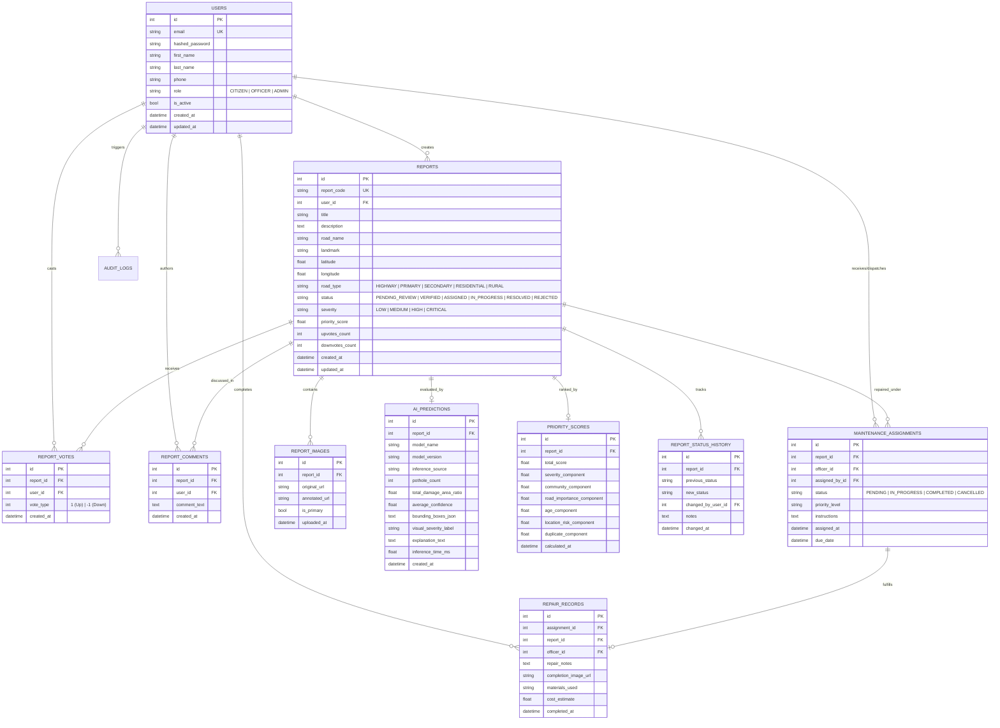

# FixMyRoad AI — Relational Database Schema & Data Dictionary

This document specifies the database architecture, table definitions, foreign key relationships, and indexing strategies used in **FixMyRoad AI**.

---

## 1. Entity-Relationship Diagram (ERD)

---

## 2. Table Specifications & Data Dictionary

### 2.1. `users` Table
Stores authentication credentials and role authorization levels.
| Column | Type | Constraints | Description |
| :--- | :--- | :--- | :--- |
| `id` | `INTEGER` | `PRIMARY KEY`, `AUTOINCREMENT` | Unique identifier |
| `email` | `VARCHAR(255)` | `UNIQUE`, `NOT NULL`, `INDEX` | User login email address |
| `hashed_password` | `VARCHAR(255)` | `NOT NULL` | Direct Bcrypt salted password hash |
| `first_name` | `VARCHAR(100)` | `NOT NULL` | Given name |
| `last_name` | `VARCHAR(100)` | `NOT NULL` | Surname |
| `phone` | `VARCHAR(30)` | `NULLABLE` | Contact telephone number |
| `role` | `VARCHAR(20)` | `NOT NULL`, `DEFAULT 'CITIZEN'` | `CITIZEN`, `OFFICER`, or `ADMIN` |
| `is_active` | `BOOLEAN` | `NOT NULL`, `DEFAULT TRUE` | Account activation flag |
| `created_at` | `DATETIME` | `NOT NULL` | Timestamp of account creation |
| `updated_at` | `DATETIME` | `NOT NULL` | Timestamp of last profile update |

### 2.2. `reports` Table
Primary entity representing citizen hazard submissions and municipal tickets.
| Column | Type | Constraints | Description |
| :--- | :--- | :--- | :--- |
| `id` | `INTEGER` | `PRIMARY KEY`, `AUTOINCREMENT` | Unique report identifier |
| `report_code` | `VARCHAR(30)` | `UNIQUE`, `NOT NULL`, `INDEX` | Human-readable code (e.g. `FMR-2026-00001`) |
| `user_id` | `INTEGER` | `FOREIGN KEY (users.id)` | Submitting citizen ID |
| `title` | `VARCHAR(255)` | `NOT NULL` | Hazard summary headline |
| `description` | `TEXT` | `NULLABLE` | Detailed description of road damage |
| `road_name` | `VARCHAR(255)` | `NULLABLE` | Highway, avenue, or street name |
| `landmark` | `VARCHAR(255)` | `NULLABLE` | Cross-street or prominent building |
| `latitude` | `FLOAT` | `NOT NULL`, `INDEX` | WGS84 geographic latitude coordinate |
| `longitude` | `FLOAT` | `NOT NULL`, `INDEX` | WGS84 geographic longitude coordinate |
| `road_type` | `VARCHAR(30)` | `NOT NULL` | Highway, Primary, Secondary, Residential, Rural |
| `status` | `VARCHAR(30)` | `NOT NULL`, `INDEX` | `PENDING_REVIEW`, `VERIFIED`, `IN_PROGRESS`, `RESOLVED`, `REJECTED` |
| `severity` | `VARCHAR(20)` | `NOT NULL`, `INDEX` | `LOW`, `MEDIUM`, `HIGH`, `CRITICAL` |
| `priority_score` | `FLOAT` | `NOT NULL`, `DEFAULT 0.0`, `INDEX` | Algorithmic 0–100 urgency score |
| `upvotes_count` | `INTEGER` | `NOT NULL`, `DEFAULT 0` | Total community upvotes |
| `downvotes_count`| `INTEGER` | `NOT NULL`, `DEFAULT 0` | Total community downvotes |
| `created_at` | `DATETIME` | `NOT NULL` | Timestamp of submission |
| `updated_at` | `DATETIME` | `NOT NULL` | Timestamp of status or vote change |

### 2.3. `ai_predictions` Table
Detailed output metrics generated by Computer Vision models.
| Column | Type | Constraints | Description |
| :--- | :--- | :--- | :--- |
| `id` | `INTEGER` | `PRIMARY KEY`, `AUTOINCREMENT` | Unique prediction identifier |
| `report_id` | `INTEGER` | `FOREIGN KEY (reports.id)` | Associated road hazard report |
| `model_name` | `VARCHAR(100)` | `NOT NULL` | Model identifier (`YOLOv8-RoadDamage`) |
| `model_version` | `VARCHAR(30)` | `NOT NULL` | Weight/architecture version |
| `inference_source`| `VARCHAR(50)` | `NOT NULL` | `yolov8_local`, `cv_structural_analyzer`, or `roboflow_api` |
| `pothole_count` | `INTEGER` | `NOT NULL` | Total craters detected |
| `total_damage_area_ratio`| `FLOAT` | `NOT NULL` | Damaged pixels divided by total frame area |
| `average_confidence`| `FLOAT` | `NOT NULL` | Mean model confidence across detected boxes |
| `bounding_boxes_json`| `TEXT` | `NOT NULL` | JSON array of `[x1, y1, x2, y2, confidence, class]` |
| `visual_severity_label`| `VARCHAR(20)` | `NOT NULL` | Derived visual severity tag |
| `explanation_text`| `TEXT` | `NULLABLE` | Natural-language reasoning justification |
| `inference_time_ms`| `FLOAT` | `NOT NULL` | Inference latency in milliseconds |

### 2.4. `priority_scores` Table
Audit records storing the component breakdown of the 6-factor prioritization math engine.
| Column | Type | Description |
| :--- | :--- | :--- |
| `total_score` | `FLOAT` | Composite 0–100 priority score |
| `severity_component` | `FLOAT` | Max 30.0 pts from visual severity |
| `community_component` | `FLOAT` | Max 20.0 pts from net citizen upvotes |
| `road_importance_component`| `FLOAT` | Max 15.0 pts from arterial classification |
| `age_component` | `FLOAT` | Max 15.0 pts from waiting time escalation |
| `location_risk_component` | `FLOAT` | Max 10.0 pts from hospital/school proximity |
| `duplicate_component` | `FLOAT` | Max 10.0 pts from 25m duplicate density |

---

## 3. Database Indexes

- `idx_reports_coords`: `CREATE INDEX idx_reports_coords ON reports(latitude, longitude);` (Powers radius proximity search).
- `idx_reports_priority`: `CREATE INDEX idx_reports_priority ON reports(priority_score DESC);` (Powers dispatch order).
- `idx_reports_status`: `CREATE INDEX idx_reports_status ON reports(status);` (Powers municipal lifecycle filtering).
- `idx_votes_unique`: `CREATE UNIQUE INDEX uq_vote ON report_votes(report_id, user_id);` (Enforces 1 vote per citizen).

