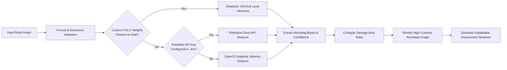

# FixMyRoad AI — Machine Learning & Computer Vision Pipelines

This document provides a comprehensive technical breakdown of the Artificial Intelligence and Machine Learning models integrated into **FixMyRoad AI**.

---

## 1. Overview of AI/ML Modules

| Model Module | Technique / Architecture | Artifact / Engine | Primary Task |
| :--- | :--- | :--- | :--- |
| **Pothole Detection** | YOLOv8 + OpenCV Saliency | `yolov8n.pt` / Adaptive Contours | Object detection & crater bounding boxes |
| **Prioritization Engine** | Multi-Factor Weighted Index | Mathematical Equation | Normalized 0–100 municipal urgency score |
| **Bridge Lifespan Regressor** | Extreme Gradient Boosting (`XGBRegressor`) | `models/bridge_life_model.pkl` | Predicts remaining operational life in years |
| **Turnaround Forecaster** | Supervised Regression | Statistical MTTR heuristic | Estimates repair hours based on road class & severity |
| **Spatial Cluster Finder** | DBSCAN Density Clustering | Scikit-Learn `DBSCAN` | Groups hazards into continuous failure corridors |

---

## 2. Computer Vision Road Damage Pipeline



### 2.1. Dual-Engine Architecture
1. **Ultralytics YOLOv8**:
   - Detects craters and asphalt fractures with bounding coordinates $[x_1, y_1, x_2, y_2]$ and confidence $c \in [0, 1]$.
   - Default confidence threshold: `0.40`.
2. **OpenCV Structural & Texture Analyzer (Zero-Dependency Offline Engine)**:
   - Evaluates image without requiring GPU or network socket access.
   - Converts BGR image to grayscale:
     $$Y = 0.299R + 0.587G + 0.114B$$
   - Applies Gaussian smoothing with kernel $k = (7, 7)$:
     $$G(x, y) = \frac{1}{2\pi\sigma^2} e^{-\frac{x^2+y^2}{2\sigma^2}}$$
   - Executes Adaptive Gaussian Thresholding:
     $$T(x, y) = \text{mean}(\text{block}) - C, \quad \text{where } \text{blockSize} = 25, C = 4$$
   - Morphological closure using an elliptical kernel $k = (9, 9)$ to bridge cracked asphalt fissures.
   - Filters contours based on frame coverage ratio ($0.5\% \le \text{area} \le 40\%$) and aspect ratio ($0.3 \le \frac{w}{h} \le 3.5$).

### 2.2. Damage Ratio Calculation
The percentage of the visible road surface damaged is calculated by summing non-overlapping bounding box areas normalized by total image pixel area:
$$\text{Damage Area Ratio} = \frac{\sum_{i=1}^{N} (x_{2,i} - x_{1,i}) \times (y_{2,i} - y_{1,i})}{\text{Width} \times \text{Height}}$$

---

## 3. XGBoost Bridge Lifespan Prediction Pipeline

### 3.1. Model Architecture
- **Framework**: `xgboost.sklearn.XGBRegressor` (Extreme Gradient Boosted Trees).
- **Model Path**: `backend/models/bridge_life_model.pkl`
- **Scaler Path**: `backend/models/scaler.pkl` (`sklearn.preprocessing.StandardScaler`)
- **Categorical Encoders**:
  - `models/material_encoder.pkl`
  - `models/maintenance_level_encoder.pkl`
  - `models/environmental_conditions_encoder.pkl`
  - `models/cracks_detected_encoder.pkl`

### 3.2. Feature Engineering & Preprocessing
Input vector $\mathbf{x}_{\text{raw}}$ consists of 8 features:
1. `age`: Integer $\in [1, 150]$ (Years since construction)
2. `material`: Categorical (`Concrete`, `Steel`, `Composite`, `Prestressed Concrete`)
3. `span_length`: Float $\in [5.0, 500.0]$ (Meters)
4. `traffic_load`: Integer $\in [100, 250000]$ (Average Daily Traffic, ADT)
5. `maintenance_level`: Categorical (`Poor`, `Fair`, `Good`, `Excellent`)
6. `environmental_conditions`: Categorical (`Mild`, `Moderate`, `Severe`, `Marine`)
7. `cracks_detected`: Categorical (`None`, `Minor`, `Moderate`, `Severe`)
8. `corrosion_level`: Integer $\in [0, 10]$

Continuous features are standardized via:
$$z = \frac{x - \mu}{\sigma}$$
Categorical features are encoded using the preserved `LabelEncoder` classes.

### 3.3. Degradation Index Calculation
The degradation index represents the consumed operational capacity of the structure:
$$\text{Degradation Index} = \min\left(100.0, \max\left(0.0, \frac{\text{Age}}{\text{Age} + \text{Remaining Life}} \times 100\right)\right)$$

Risk tiers:
- **Low Risk**: Degradation $< 40\%$ and Remaining Life $> 30$ years.
- **Medium Risk**: Degradation $40–60\%$ and Remaining Life $15–30$ years.
- **High Risk**: Degradation $60–80\%$ and Remaining Life $5–15$ years.
- **Critical Risk**: Degradation $> 80\%$ or Remaining Life $< 5$ years.

---

## 4. Retraining & Evaluation Scripts

To retrain the bridge regression model or update encoder mappings:
```python
import joblib
import pandas as pd
from xgboost import XGBRegressor
from sklearn.preprocessing import StandardScaler, LabelEncoder

# 1. Load dataset
df = pd.read_csv("bridge_data.csv")

# 2. Fit encoders and scaler
le_mat = LabelEncoder().fit(df["material"])
scaler = StandardScaler().fit(df[["age", "span_length", "traffic_load", "corrosion_level"]])

# 3. Fit XGBoost Regressor
model = XGBRegressor(n_estimators=200, max_depth=6, learning_rate=0.05, random_state=42)
model.fit(X_train, y_train)

# 4. Serialize
joblib.dump(model, "backend/models/bridge_life_model.pkl")
joblib.dump(scaler, "backend/models/scaler.pkl")
```

